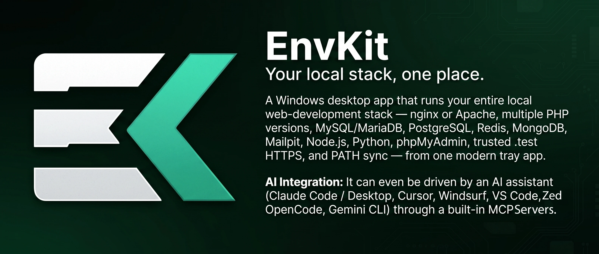
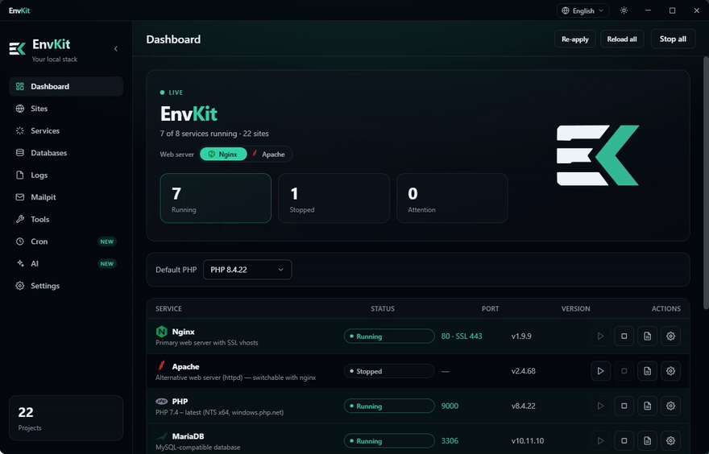
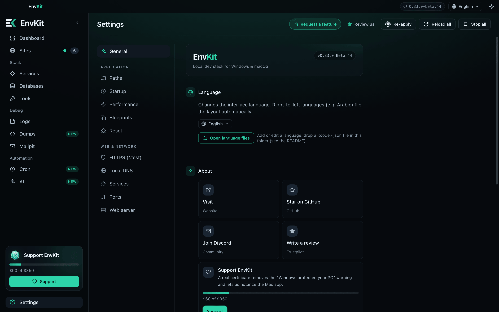

<div align="center">




# EnvKit — local development environment for Windows & macOS

**Your local stack, one place.** A free Laragon / XAMPP / Herd alternative.

EnvKit is a desktop app that runs your entire local web-development stack — nginx **or**
Apache, multiple PHP versions, MySQL/MariaDB, PostgreSQL, Redis, MongoDB, Mailpit, Node.js,
Python, phpMyAdmin, trusted `.test` HTTPS, and PATH sync — from one modern tray app. Build
Laravel, WordPress, PHP, and Node/React/Next.js/Angular sites locally with one-click services and
trusted local SSL. It can even be **driven by an AI assistant** (Claude Code / Desktop, Cursor,
Windsurf, VS Code, Zed, OpenCode, Gemini CLI, PhpStorm/JetBrains) through a built-in MCP server.

[](#requirements)
[](#install)
[](https://github.com/Env-Kit/envkit-releases/releases/latest)
[](https://envkit.net/)
[](https://www.trustpilot.com/evaluate/envkit.net)
[](https://ko-fi.com/envkit)



</div>

---

> **This repository is the public home for EnvKit releases & documentation.** Visit the [**website**](https://envkit.net/) for features, screenshots, and comparisons, or grab the
> installer from the [**Releases**](https://github.com/Env-Kit/envkit-releases/releases/latest)
> page. The application source is maintained privately.

EnvKit is free, with no limit on the number of sites and no popup asking you to upgrade.
Switching from another tool? See how it compares to
[Laragon](https://envkit.net/laragon-alternative),
[Herd](https://envkit.net/herd-alternative), and
[XAMPP](https://envkit.net/xampp-alternative).

## What's new

In 0.33.0-beta.43 ([full notes](https://github.com/Env-Kit/envkit-releases/releases/latest)):

- Apache starts again when the data folder path has spaces in it, and the update check
  no longer hangs.
- The site terminal uses the site's own PHP and Node versions, Cmder included.
- Live reload can also refresh your other tabs after you save in WordPress admin or a
  Laravel form.
- Services → Node.js lists npm, pnpm, Yarn and Bun, and can install or update pnpm and Yarn.
  Cron has templates for Node and NestJS sites.
- `envkit.json` can list required PHP extensions and php.ini values, with a per-developer
  `envkit.local.json` on top. Also: Adminer 6.1.2 and "Show in Finder" on macOS.

## Install

### Windows

Download the latest **`EnvKit-Setup-x.y.z.exe`** from the
[releases page](https://github.com/Env-Kit/envkit-releases/releases/latest) and run it.
(SmartScreen may warn on first run — **More info → Run anyway**; EnvKit is self-signed.)

### macOS (Apple Silicon)

One-line install (downloads the latest macOS build, strips the Gatekeeper quarantine, opens it):

```bash
curl -fsSL https://raw.githubusercontent.com/Env-Kit/envkit-releases/main/install.sh | bash
```

Run the same command again any time to update. To uninstall: add `-s -- --uninstall`.

Or with Homebrew:

```bash
brew install --cask env-kit/tap/envkit
```

> The installer always fetches the newest release that ships a macOS build. Windows and
> macOS are released independently, so the very latest tag is sometimes Windows-only — the
> script (and the in-app updater) skip past it to the latest Mac build automatically.

Or download **`EnvKit-x.y.z-arm64.dmg`** manually from the
[releases page](https://github.com/Env-Kit/envkit-releases/releases) (pick the newest release
that lists an `-arm64.dmg` asset), open it, and
drag **EnvKit** to Applications. The app is Developer-ID signed but not yet notarized, so
macOS may block the first launch (right-click → Open no longer works on macOS 15). Any one
of these gets past it:

- open it once, then go to System Settings → Privacy & Security and click **Open Anyway**;
- use the `curl` one-liner above, which clears the quarantine for you;
- run `xattr -dr com.apple.quarantine /Applications/EnvKit.app`.

Notarization is pending on Apple's side; we'll switch it on as soon as it's available, no
action needed on your end.

EnvKit no longer supports Intel Macs — Apple Silicon (M-series) only.

EnvKit **auto-updates** on both platforms: once installed, it checks GitHub for new releases
and installs them in place (Settings → Updates lets you check/download manually). On first
launch a short **onboarding wizard** asks your source — **Load from Laragon** (a guided
detect → import flow, including databases) or **Start fresh** (pick your stack and install
the runtimes it needs).

Upgrading from a previous version? Your data directory, certificates, and settings are
**migrated automatically** on first launch — nothing to do.

## Requirements

- Windows 10 / 11, or
- macOS 12 Monterey or later (Apple Silicon only)

## What EnvKit changes on your system

EnvKit is designed to run side-by-side with whatever you already have installed. For
developers who want the full picture, this is everything it touches (Windows):

- **Windows Defender exclusions.** The installer excludes EnvKit's install folder
  (real-time scanning otherwise locks the freshly installed exe and the first launch
  fails), and the app excludes its own `services` and `tools` folders plus the bundled
  service executables (php, nginx, mysqld, …) so scanning doesn't quarantine or slow
  them. The installer's exclusion is removed on uninstall. Only Microsoft Defender is
  affected; scoped to EnvKit's own folders.
- **Trusted certificates.** Two certificates go into the Trusted Root store: EnvKit's
  code-signing certificate (so auto-updates verify — there is no paid EV/OV cert yet),
  and the local CA that signs the HTTPS certificates for your `.test` sites. The
  code-signing cert is removed on uninstall.
- **hosts file.** One `127.0.0.1 <site>.test` entry per site, removed when the site is
  removed.
- **PATH.** The bundled tools (php, composer, node, git, mysql, redis-cli, …) are added
  to your user PATH (optionally machine PATH) and kept in sync. Settings → Environment
  shows the exact folders and lets you re-sync or opt out.
- **No Windows services, no firewall rules, no drivers.** Services (nginx, PHP, MySQL,
  …) run as child processes of the app: they start when EnvKit starts and stop when it
  quits.

Existing software (PHP, Node, PostgreSQL, nginx installed on your machine) is never
replaced, modified, or uninstalled — EnvKit installs its own copies inside its data
directory and runs them side-by-side. Processes belonging to installed Windows services
or Program Files software are left running; only portable dev stacks that hold the same
ports/locks (Laragon, XAMPP, WAMP) are stopped during an install.

## Screenshots

**Dashboard**


**Sites**


**Services**


**Tools**


**AI (MCP)**


**Settings**



## Highlights

- **Windows _and_ macOS** — one app, the same stack on both (signed build for Apple Silicon).
- **nginx _or_ Apache**, switchable in Settings — PHP via FastCGI on both.
- **Trusted `.test` HTTPS** for every site via an auto-installed local CA.
- **Multiple PHP versions** with **per-site isolation** and **Xdebug on-demand**.
- **Bundled databases & tools** — MySQL/MariaDB (incl. **MySQL 8**), PostgreSQL, Redis,
  **MongoDB**, **Mailpit**, Node.js, **Python**, phpMyAdmin, plus Composer/Git/gh/nvm/ngrok/Cmder
  installers.
- **Custom versions** — install an arbitrary typed version of MySQL/MariaDB, nginx, Node.js,
  MongoDB, Redis, PostgreSQL, or Python.
- **Per-project Git** — a built-in Git panel per site: stage/commit, branches, fetch/pull/push,
  and history, with bundled Git + GitHub CLI.
- **Node / React / Next.js / Angular / Vite dev sites** reverse-proxied at `.test` HTTPS with
  **hot-reload**, plus a **live dev-server output** viewer.
- **Laravel Reverb (WebSockets)** — one-click install, supervise, and proxy per site.
- **Import from Laragon** — projects **and** databases (incl. MySQL → MariaDB transfer).
- **Diagnose & self-heal services** — find port conflicts / stale PIDs / bad configs and
  repair them.
- **AI control via MCP** — let Claude Code/Desktop, Cursor, Windsurf, VS Code, Zed, OpenCode,
  Gemini CLI, or PhpStorm/JetBrains (via Junie) operate your stack: add/remove sites, manage
  MySQL databases, start/stop and diagnose services.
- **Clean PATH, your way** — sync to the **user** or **system (Machine)** PATH, with stale
  entries pruned and **competing stacks (Laragon/XAMPP/WAMP/MAMP/Herd…) auto-removed** so
  nothing shadows EnvKit's `php`/`mysql`/`nginx`.
- **Light/dark UI in five languages** — English, العربية, Deutsch, فارسی, and Español, with
  right-to-left layout where needed. Bahasa Indonesia is coming soon.
- **Free to use** (proprietary — not open source) with **silent auto-update**.

## How EnvKit compares

A best-effort snapshot (mid-2026) against other popular local PHP stacks.

| Feature | **EnvKit** | Laravel Herd | Laragon | AppServ | XAMPP |
|---|:---:|:---:|:---:|:---:|:---:|
| Platform | Windows **+** macOS | macOS, Windows | Windows | Windows | Win / macOS / Linux |
| Price / license | Free · proprietary | Free + paid Pro | Free | Free | Free |
| Web server | nginx **+** Apache | nginx | Apache + nginx | Apache | Apache |
| Multiple PHP versions | ✅ | ✅ | ✅ | ❌ | ❌ |
| Per-site PHP isolation | ✅ | ✅ | 🟡 | ❌ | ❌ |
| Auto `.test` domains | ✅ | ✅ | ✅ | ❌ | ❌ |
| Trusted local HTTPS | ✅ | ✅ | ✅ | ❌ | 🟡 manual |
| MySQL / MariaDB | ✅ | 💲 Pro | ✅ | ✅ | ✅ |
| PostgreSQL | ✅ | 💲 Pro | 🟡 | ❌ | ❌ |
| Redis | ✅ | 💲 Pro | 🟡 | ❌ | ❌ |
| MongoDB | ✅ | ❌ | 🟡 | ❌ | ❌ |
| DB web admin UIs (Postgres/Mongo) | ✅ | ❌ | ❌ | ❌ | ❌ |
| Mail catcher (Mailpit) | ✅ | 💲 Pro | ❌ | ❌ | 🟡 Mercury |
| Node.js | ✅ | 🟡 | ✅ | ❌ | ❌ |
| Node / React / Next.js / Angular dev sites | ✅ | 🟡 | 🟡 | ❌ | ❌ |
| Laravel Reverb (WebSockets) | ✅ | 🟡 | ❌ | ❌ | ❌ |
| nvm + per-project `.nvmrc` | ✅ | ❌ | ❌ | ❌ | ❌ |
| Python | ✅ | ❌ | 🟡 | ❌ | ❌ |
| Composer / Laravel scaffolding | ✅ | ✅ | ✅ | ❌ | ❌ |
| Built-in Git panel (stage / commit / branches) | ✅ | ❌ | 🟡 | ❌ | ❌ |
| Light / dark UI | ✅ | ✅ | 🟡 | ❌ | ❌ |
| Multi-language UI (+ RTL) | ✅ | ❌ | 🟡 | ❌ | ❌ |
| Import from Laragon (projects **+ databases**) | ✅ | ❌ | — | ❌ | ❌ |
| AI control via MCP | ✅ | ❌ | ❌ | ❌ | ❌ |
| Diagnose & self-heal services | ✅ | ❌ | ❌ | ❌ | ❌ |
| Auto-update | ✅ | ✅ | 🟡 | ❌ | ❌ |

<sub>✅ built-in · 🟡 partial / via add-on · ❌ not available · 💲 paid tier</sub>

## AI access (MCP)

EnvKit ships an MCP server so AI assistants can operate your local stack.

1. Open **Settings → AI** and toggle **Enable MCP server**.
2. Click **Set up AI clients** — EnvKit registers itself **globally** with Claude Code /
   Desktop, Cursor, Windsurf, VS Code, Zed, OpenCode, Gemini CLI, and PhpStorm/JetBrains
   (via Junie), and installs an `envkit` skill. (Or copy the shown URL config into your
   client's `mcpServers` yourself — for the JetBrains AI Assistant chat, paste it in
   Settings → Tools → AI Assistant → Model Context Protocol → Add.)
3. **Restart your AI client**, then ask things like *"start redis"*, *"diagnose why mysql
   won't start, then repair it"*, or *"list my Laravel sites"*.

The endpoint is local-only (`http://127.0.0.1:<port>/mcp`), bearer-token authenticated, off
by default, and only works while EnvKit is running.

## Reporting issues

Found a bug or have a feature request?
[Open an issue](https://github.com/Env-Kit/envkit/issues). Please include your OS and
version, EnvKit version, and steps to reproduce.

For anything else, reach us at [info@envkit.net](mailto:info@envkit.net).

## Support EnvKit

EnvKit is free. If it saves you time, you can support it on
[Ko-fi](https://ko-fi.com/envkit). The current goal is $350 for two things:

- a real Windows code-signing certificate, so installing no longer shows
  "Windows protected your PC" and updates verify on every machine;
- an Apple Developer membership, so the Mac app can be notarized and opens
  without a warning.

We post the receipts on [Discord](https://discord.gg/2ArBwMX8pV) once they're bought.

## Team

EnvKit is built and maintained by:

- **Ziad Talaat** — [@zsnakeee](https://github.com/zsnakeee)
- **Kirlos Osama** — [@ker00sama-dev](https://github.com/ker00sama-dev)
- **Youssef Yasser** — [@7aWy11](https://github.com/7aWy11)

## License

**EnvKit is free to use**, but it is **not open source**. All rights reserved.

<div align="center">

<sub>EnvKit · <a href="https://github.com/Env-Kit">Env-Kit</a></sub>

</div>
