<div align="center">

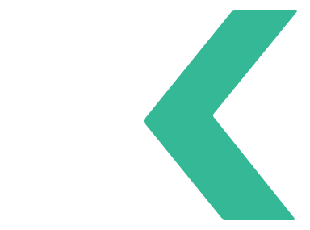

# EnvKit

**Your local stack, one place.**

A free local development environment for Windows and macOS: nginx or Apache, any PHP
version, MySQL, PostgreSQL, Redis and trusted `.test` HTTPS, from one desktop app.
A Laragon, XAMPP and Herd alternative.

[](https://github.com/Env-Kit/envkit-releases/releases/latest)
[](https://github.com/Env-Kit/envkit-releases/releases)
[](#install)
[](#install)
[](https://envkit.net/docs)
[](https://discord.gg/2ArBwMX8pV)
[](https://ko-fi.com/envkit)

**[Download for Windows](https://stats.envkit.net/d/win?c=gh-readme)** ·
**[Download for macOS](https://stats.envkit.net/d/mac?c=gh-readme)** ·
[Website](https://envkit.net) ·
[Docs](https://envkit.net/docs) ·
[Changelog](https://envkit.net/changelog)

<a href="art/envkit-demo.mp4"></a>

</div>

EnvKit runs your whole PHP and Node stack as native processes, managed from a tray app.
No Docker, no WSL, no config files to hand-edit. Install it, pick your stack, and the
first-run wizard ends with a working site open in your browser over HTTPS.

Free, with no limit on sites and no upgrade popups. Moving from another tool? See how it
compares to [Laragon](https://envkit.net/laragon-alternative),
[Herd](https://envkit.net/herd-alternative) and
[XAMPP](https://envkit.net/xampp-alternative).

## Features

### Sites, domains and HTTPS

- 🌐 **Automatic `.test` domains with trusted HTTPS.** Every site gets a hostname and a
  certificate from EnvKit's local CA, trusted by your browser with no warnings.
- 🧱 **Any kind of project.** Laravel, WordPress, Bedrock, CodeIgniter, plain PHP, and
  Node, React, Next.js, Vite and Angular dev servers, all served at `.test` over HTTPS with
  hot reload and a live view of the dev server's output.
- 🚀 **New projects in one step.** Start a Laravel, WordPress or Node project, clone a Git
  repo, or link a folder you already have.
- 🔗 **Site groups.** Keep related sites together, and switch any site off or put it to sleep
  when you don't need it.
- 🌍 **Share a site publicly.** One click gives a site a public `https://<name>.envkit.net`
  link to show a client or test a webhook, with a Stop button when you're done.
- 🔄 **Live reload.** Save a file and the browser refreshes, including your other open tabs
  after a WordPress admin or Laravel form save.

### PHP, Node and runtimes

- 🐘 **Multiple PHP versions, per site.** Run each site on its own PHP version, isolated
  from the others, with Xdebug switched on only when you want it.
- 🧰 **Your choice of web server.** nginx, Apache, Caddy or FrankenPHP, switched from
  Settings.
- 📦 **Node.js with nvm.** Per-project versions from `.nvmrc`, plus npm, pnpm, Yarn and Bun.
  Python, Go and Deno are one click away.
- 🧷 **Custom versions.** Install any version of MySQL/MariaDB, nginx, Node.js, MongoDB,
  Redis, PostgreSQL or Python by typing its number.
- 📄 **`envkit.json`.** Commit a project's required PHP extensions and `php.ini` values, with
  a per-developer `envkit.local.json` on top.

### Databases and services

- 🗄️ **One-click services.** MySQL/MariaDB (including MySQL 8), PostgreSQL, Redis, MongoDB,
  Memcached, Meilisearch, MinIO and Mailpit.
- 🧭 **Database admin built in.** phpMyAdmin, Adminer, pgAdmin for PostgreSQL and a Mongo
  web UI, opened already pointed at your local server.
- 📬 **Mail catcher.** Mailpit captures every email your app sends, with its own page in
  the app.
- 🛟 **Backups that respect your data.** Back up and restore a site's database from its
  page. A MySQL data folder that still has your databases in it is never re-initialized.

### Debugging and everyday tools

- 🩺 **Diagnose and self-heal.** Finds port conflicts, stale PIDs and broken configs and
  repairs them. If another program holds a port, EnvKit moves to a free one instead of
  failing.
- 🛰️ **Dumps and logs.** `dump()` output and every service's logs in one place.
- ⏰ **Scheduled tasks (Cron).** Run commands on a schedule, with templates for Laravel,
  Node and NestJS.
- 🔀 **Git panel per site.** Stage, commit, switch branches, fetch, pull and push, with Git
  and the GitHub CLI bundled.
- 📡 **Laravel Reverb.** One-click install, supervision and proxying of WebSockets per site,
  plus queue workers and the scheduler.
- 🧹 **Clean PATH.** `php`, `composer`, `node`, `mysql` and friends on your PATH, with
  competing stacks (Laragon, XAMPP, WAMP, MAMP, Herd) removed so nothing shadows them.

### App

- 🖥️ **One tray app for everything.** Dashboard, sites, services, databases, logs, mail and
  cron, in light or dark.
- 🌏 **Six languages.** English, العربية, Deutsch, فارسی, Español and Bahasa Indonesia,
  with right-to-left layout where needed.
- 🔁 **Import from Laragon.** Projects **and** databases, in a guided detect-and-import flow.
- ⬆️ **Silent auto-update** on both platforms, with small differential downloads.

## AI integration (MCP)

EnvKit ships a built-in [Model Context Protocol](https://modelcontextprotocol.io/) server,
so an AI assistant can run your local stack for you. Turn it on in **Settings → AI** and
click **Set up AI clients**: EnvKit registers itself with Claude Code and Claude Desktop,
Cursor, Windsurf, VS Code, Zed, OpenCode, Gemini CLI and PhpStorm (via Junie).

Then just ask:

```
You: mysql won't start, fix it
AI:  → diagnose_service(mysql)    # port 3306 held by another process
     → repair_service(mysql)      # frees the port, fixes the config, starts it
     ✓ mysql is running

You: make a new Laravel site called shop with its own database
AI:  → create_laravel_site(shop)
     → create_database(shop)
     ✓ https://shop.test is ready
```

The server listens on `127.0.0.1` only, uses a bearer token, is off by default, and only
runs while EnvKit is open.

## Why EnvKit?

|                                   | **EnvKit** | Laravel Herd | Laragon | XAMPP |
|-----------------------------------|:----------:|:------------:|:-------:|:-----:|
| Windows **and** macOS             | ✅ | ✅ | ❌ | ✅ |
| Free, no license or paid tier     | ✅ | ❌ | ❌ | ✅ |
| nginx **and** Apache              | ✅ | ❌ | ✅ | ❌ |
| Per-site PHP version              | ✅ | ✅ | 🟡 | ❌ |
| Trusted local HTTPS               | ✅ | ✅ | ✅ | 🟡 |
| MySQL, PostgreSQL, Redis included | ✅ | 💲 | 🟡 | 🟡 |
| MongoDB                           | ✅ | ❌ | 🟡 | ❌ |
| Mail catcher                      | ✅ | 💲 | ❌ | 🟡 |
| Node / Next.js / Vite dev sites   | ✅ | 🟡 | 🟡 | ❌ |
| Import from Laragon (with databases) | ✅ | ❌ | — | ❌ |
| AI control via MCP                | ✅ | ✅ | ❌ | ❌ |
| Multi-language UI (with RTL)      | ✅ | ❌ | 🟡 | ❌ |
| Auto-update                       | ✅ | ✅ | 🟡 | ❌ |

<sub>✅ built in · 🟡 partial or via add-on · ❌ not available · 💲 paid tier. A best-effort
snapshot from late 2026; tell us if something is out of date.</sub>

## Install

### Windows

[Download the installer](https://stats.envkit.net/d/win?c=gh-readme) and run it.
Windows 10 or 11.

> [!NOTE]
> EnvKit is self-signed for now, so SmartScreen may warn on the first run. Click
> **More info → Run anyway**.

<details>
<summary>Install from PowerShell instead</summary>

```powershell
irm https://raw.githubusercontent.com/Env-Kit/envkit-releases/main/install.ps1 | iex
```

Run the same command again any time to update.

</details>

### macOS (Apple Silicon)

```bash
curl -fsSL https://raw.githubusercontent.com/Env-Kit/envkit-releases/main/install.sh | bash
```

Downloads the latest Mac build, clears the Gatekeeper quarantine and opens it. Run it again
to update, or add `-s -- --uninstall` to remove EnvKit. macOS 12 or later on an M-series
Mac; Intel Macs are not supported.

<details>
<summary>Install with Homebrew instead</summary>

```bash
brew install --cask env-kit/tap/envkit
```

</details>

<details>
<summary>Install from the DMG instead</summary>

[Download the DMG](https://stats.envkit.net/d/mac?c=gh-readme), open it and drag
**EnvKit** to Applications. The app is Developer ID signed but not notarized yet, so macOS
may block the first launch. Any one of these gets past it:

- open it once, then click **Open Anyway** in System Settings → Privacy & Security;
- use the `curl` one-liner above, which clears the quarantine for you;
- run `xattr -dr com.apple.quarantine /Applications/EnvKit.app`.

Windows and macOS builds are released separately, so the very latest release is sometimes
Windows-only. The installer script and the in-app updater pick the newest Mac build
automatically.

</details>

## Quick start

1. **Open EnvKit.** The first-run wizard asks where you're coming from: **Load from
   Laragon** imports your projects and databases, **Start fresh** installs the stack you
   pick.
2. **Make your first site.** Pick a starter (a PHP or HTML page, a small Node server, or a
   new Laravel or Vite app) or link a folder you already have.
3. **Open it.** EnvKit serves it at `https://<name>.test` and opens your browser. If
   something blocks it (a busy port, an untrusted certificate, a stopped web server), the
   wizard says what and offers the fix.

Upgrading? Your sites, databases, certificates and settings carry over automatically.

## What's new

0.33.0-beta.44 ([full notes](https://github.com/Env-Kit/envkit-releases/releases/latest)):
first-run setup ends with a working site, Bahasa Indonesia, automatic port moves for
memcached and extra PHP versions, and a MySQL guard that never re-initializes a data folder
holding your databases.

## Screenshots

<table>
  <tr>
    <td>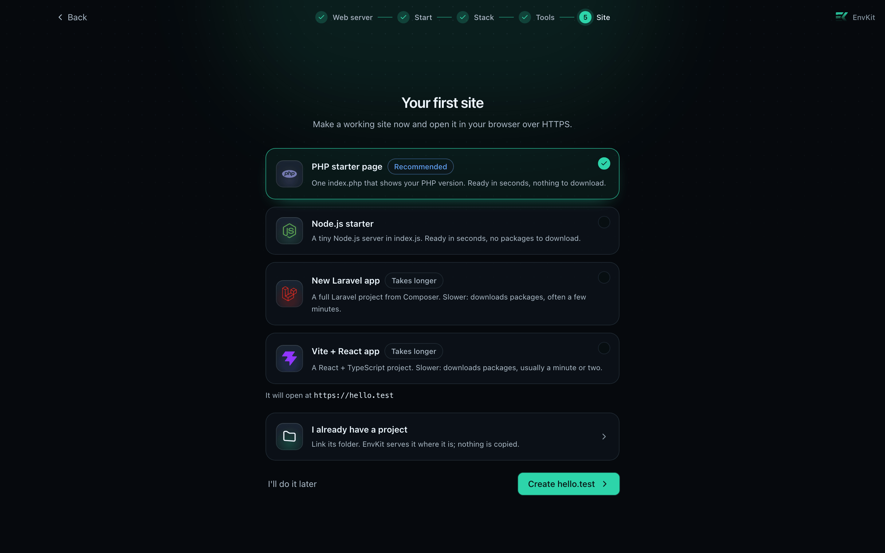<p align="center">First run: your first site</p></td>
    <td>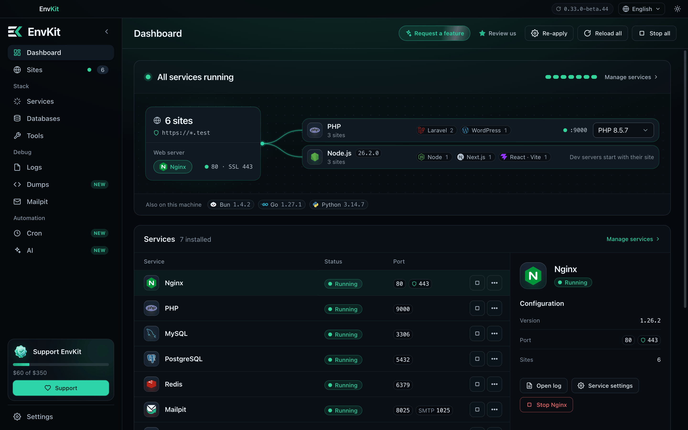<p align="center">Dashboard</p></td>
  </tr>
  <tr>
    <td>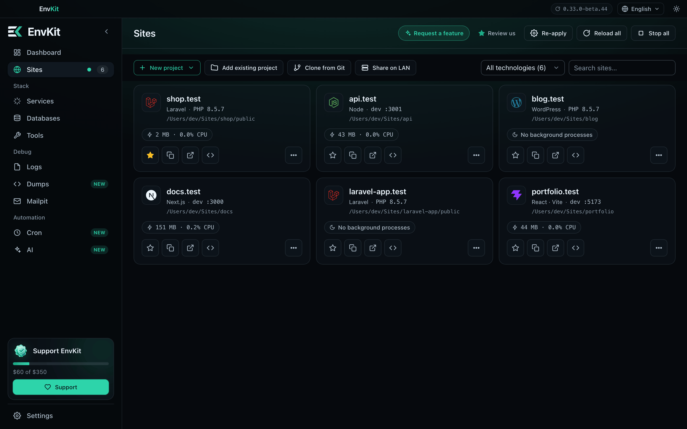<p align="center">Sites</p></td>
    <td>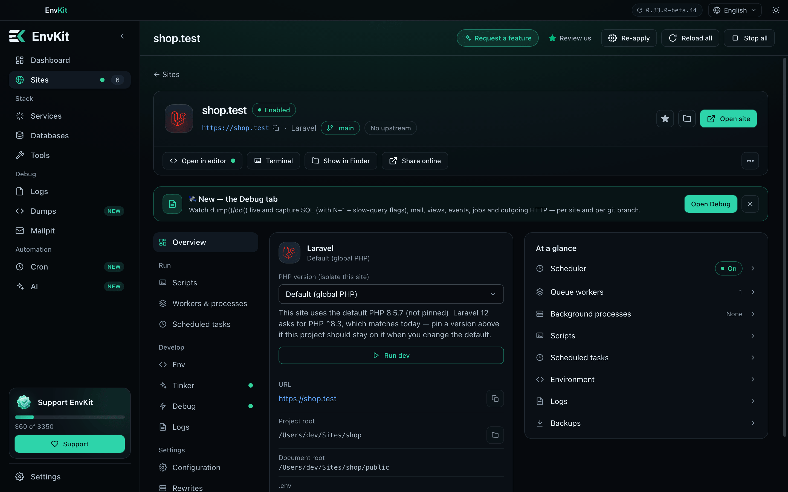<p align="center">Site detail</p></td>
  </tr>
  <tr>
    <td>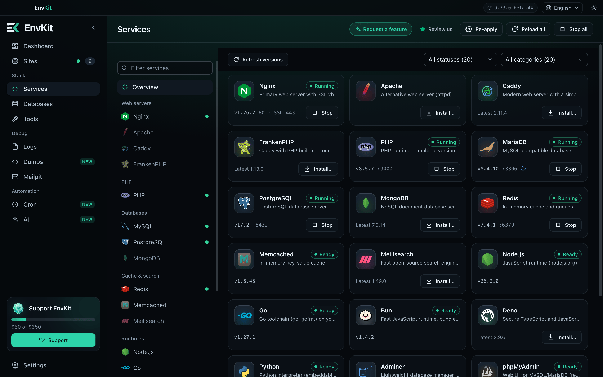<p align="center">Services</p></td>
    <td>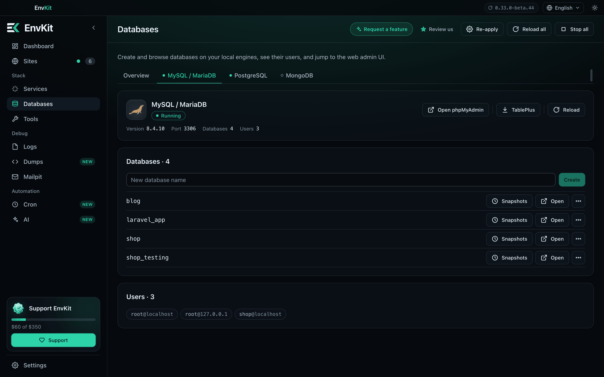<p align="center">Databases</p></td>
  </tr>
  <tr>
    <td>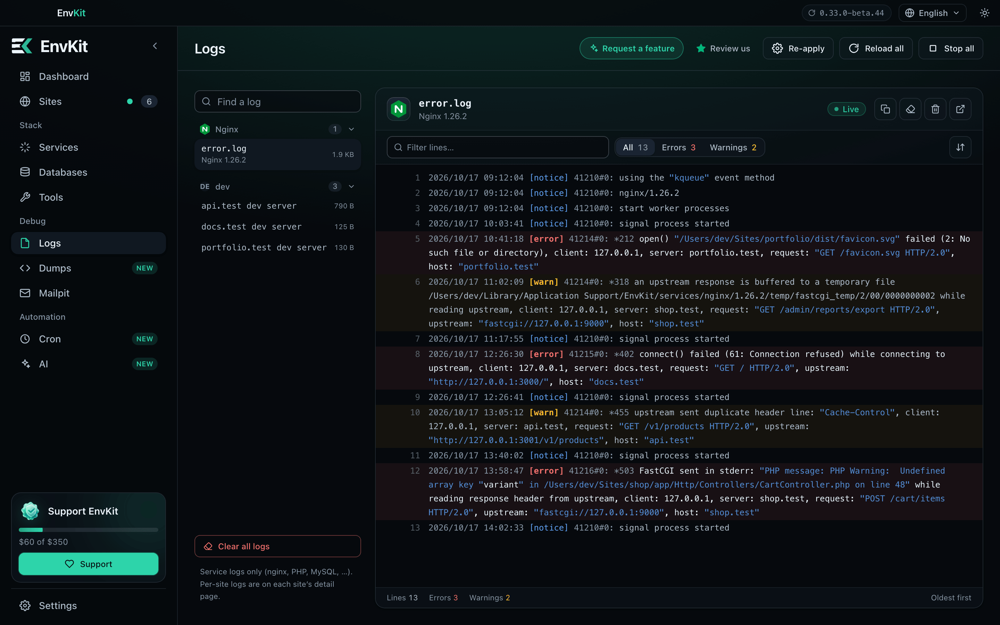<p align="center">Logs</p></td>
    <td>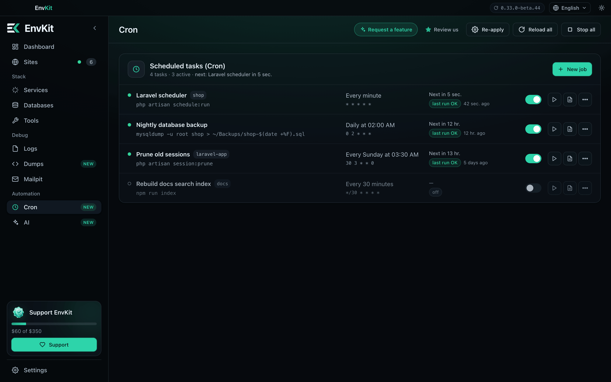<p align="center">Cron</p></td>
  </tr>
  <tr>
    <td>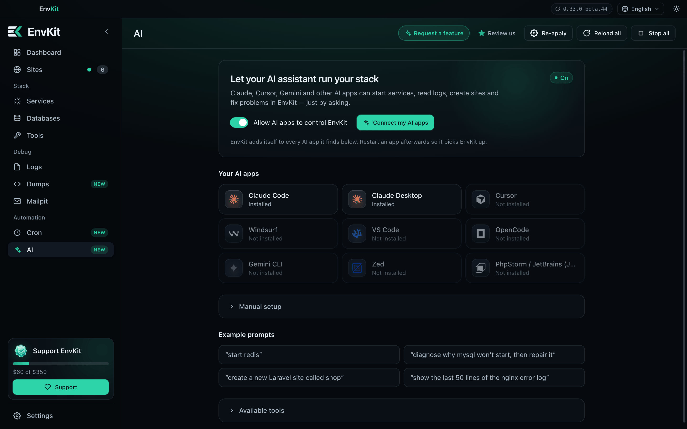<p align="center">AI (MCP)</p></td>
    <td>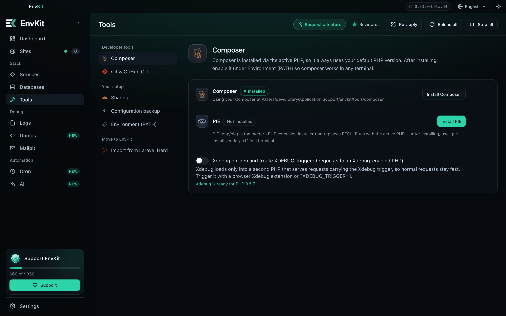<p align="center">Tools</p></td>
  </tr>
</table>

## What EnvKit changes on your system

EnvKit runs side by side with whatever you already have. It never replaces, modifies or
uninstalls PHP, Node, PostgreSQL or nginx installed on your machine; it keeps its own copies
in its data folder.

<details>
<summary>The full list (Windows)</summary>

- **Windows Defender exclusions** for EnvKit's own install, `services` and `tools` folders
  and the bundled service executables, so scanning doesn't lock or quarantine them. The
  installer's exclusion is removed on uninstall.
- **Trusted certificates.** EnvKit's code-signing certificate (so auto-updates verify;
  removed on uninstall) and the local CA that signs your `.test` certificates.
- **hosts file.** One `127.0.0.1 <site>.test` line per site, removed with the site.
- **PATH.** The bundled tools are added to your user PATH (or machine PATH if you choose)
  and kept in sync. Settings → Environment shows the exact folders and lets you opt out.
- **No Windows services, firewall rules or drivers.** Services run as child processes of
  the app and stop when it quits. Portable stacks that hold the same ports (Laragon, XAMPP,
  WAMP) are stopped only while EnvKit installs something.

</details>

## Documentation

📖 **[envkit.net/docs](https://envkit.net/docs)**: install, sites, services, databases,
PHP versions, MCP, `envkit.json`, custom versions and translating the app.

## Getting help

- **Questions and quick help:** [Discord](https://discord.gg/2ArBwMX8pV)
- **Bugs and feature requests:** [open an issue](https://github.com/Env-Kit/envkit-releases/issues/new)
  (search [existing issues](https://github.com/Env-Kit/envkit-releases/issues) first).
  Include your OS and version, the EnvKit version (Settings → Updates), what you did and
  what happened, and the relevant log lines if a service won't start.
- **Anything else:** [info@envkit.net](mailto:info@envkit.net)

## Support EnvKit

EnvKit is free. If it saves you time, you can support it on
[Ko-fi](https://ko-fi.com/envkit). The current goal is $350 for a real Windows
code-signing certificate, so installing no longer shows "Windows protected your PC", and an
Apple Developer membership, so the Mac app opens without a warning. Receipts go up on
[Discord](https://discord.gg/2ArBwMX8pV) once they're bought.

Starring this repo and leaving a review on
[Trustpilot](https://www.trustpilot.com/evaluate/envkit.net) helps too.

## Team

- **Ziad Talaat** · [@zsnakeee](https://github.com/zsnakeee)
- **Kirlos Osama** · [@ker00sama-dev](https://github.com/ker00sama-dev)
- **Youssef Yasser** · [@7aWy11](https://github.com/7aWy11)

## License

EnvKit is **free to use** but **not open source**. All rights reserved. This repository
holds the releases, installers and documentation; the application source is private.

<div align="center">

<sub>EnvKit · <a href="https://envkit.net">envkit.net</a> · <a href="https://github.com/Env-Kit">Env-Kit</a></sub>

</div>
